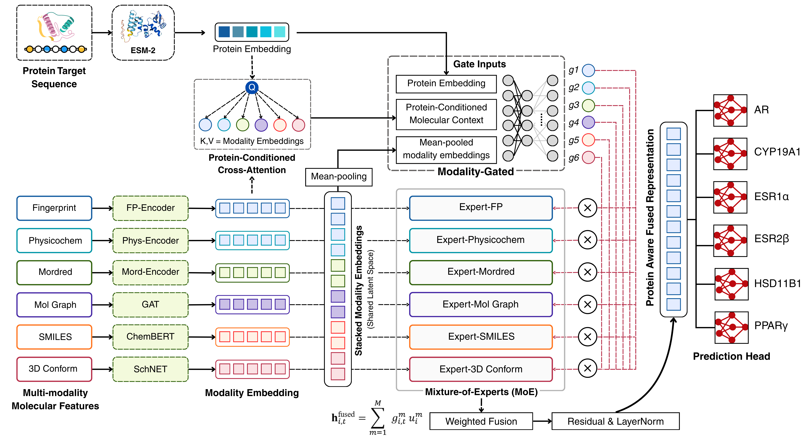

# ProCMT-QSAR — Protein-Conditioned Multimodal Multi-Task QSAR for Toxicity Assessment of Endocrine-Disrupting Chemicals

Reproducibility repository for:

> **ProCMT-QSAR: An Interpretable Target-Aware Protein-Conditioned Multimodal Multi-Task QSAR Model for Toxicity Assessment of Endocrine-Disrupting Chemicals**
>
> Fauzan Syarif Nursyafi<sup>1,2</sup>, Yunendah Nur Fuadah<sup>3</sup>, Ulfa Latifa Hanum<sup>4</sup>, Ki Moo Lim<sup>1,5,6,*</sup>
>
> <sup>1</sup>Department of Biomedical Engineering, Kumoh National Institute of Technology, Gumi, 39177, Republic of Korea  
> <sup>2</sup>Bioinformatics Research Center, Institute of Bioinformatics Indonesia, Malang, 65162, Indonesia  
> <sup>3</sup>Telecommunication Engineering Study Program, School of Electrical Engineering, Telkom University, Jl. Telekomunikasi No. 1, Bandung 40257, West Java, Indonesia  
> <sup>4</sup>Department of IT Convergence, Kumoh National Institute of Technology, Gumi, 39177, Republic of Korea  
> <sup>5</sup>Meta Heart Co., Ltd, Gumi, 39253, Republic of Korea  
> <sup>6</sup>High-tech Medical Equipment Research Institute, Kumoh National Institute of Technology, Gumi, 39177, Republic of Korea  
>
> \*Corresponding author: Ki Moo Lim, [kmlim@kumoh.ac.kr](mailto:kmlim@kumoh.ac.kr)
> 
---

## Overview

This repo provides a step-by-step tutorial pipeline that reproduces the complete methodology from raw ChEMBL data to model predictions and explainability analysis.

The model predicts whether a compound is **active** (IC50 ≤ 1,000 nM) or **non-active** (IC50 ≥ 10,000 nM) against six endocrine-relevant protein targets simultaneously, using a protein-conditioned multimodal multi-task architecture.

| Endpoint | Protein function | Endocrine disruption relevance |
|----------|-------------------|-------------------------------|
| **AR** (Androgen receptor) | Ligand-activated transcription factor mediating androgen signaling | Disruption of androgen signaling; associated with male reproductive toxicity, spermatogenesis impairment, and prostate dysfunction |
| **CYP19A1** (Aromatase) | Cytochrome P450 enzyme converting androgens to estrogens | Reduction of circulating estrogen levels; disruption of female reproduction, bone metabolism, and HPG axis feedback |
| **ESR1α** (Estrogen receptor α) | Nuclear receptor mediating estrogen signaling in uterus, breast, bone, and hypothalamus | Disruption of estrogen-regulated reproductive, skeletal, and neuroendocrine function |
| **ESR2β** (Estrogen receptor β) | Nuclear receptor with partially distinct tissue distribution from ESR1, expressed in ovary, prostate, and brain | Disruption of ovarian folliculogenesis, prostate differentiation, and neuroprotective estrogen signaling |
| **HSD11B1** (11β-HSD1) | Intracellular oxidoreductase regenerating active cortisol from cortisone in metabolic tissues | Perturbation of local glucocorticoid homeostasis; dysregulation of adipogenesis, insulin sensitivity, and HPA axis tone |
| **PPARγ** (PPARG) | Ligand-activated nuclear receptor governing adipogenesis, lipid storage, and insulin sensitization | Disruption of adipocyte differentiation and lipid metabolism; relevant to the obesogen pathway of endocrine disruption |

Compounds are classified as **active** or **non-active** per endpoint based on mechanism-relevant IC50 thresholds (active ≤ 1,000 nM; non-active ≥ 10,000 nM), reflecting potent versus negligible target engagement.

---

## ProCMT-QSAR Framework



The framework integrates six complementary molecular representations (fingerprints, physicochemical descriptors, Mordred 2D descriptors, molecular graph, SMILES sequence embedding, and 3D conformer descriptors) with protein-conditioned cross-attention and a modality-gated Mixture-of-Experts fusion module, trained jointly across six endocrine-related endpoints under a multi-task learning scheme.

---

## Methodology Summary

ProCMT-QSAR proceeds through four stages: **(1)** independent encoding of six molecular modalities into a shared latent space, **(2)** conditioning of the fused molecular representation on a target-specific ESM-2 protein embedding via cross-attention, **(3)** adaptive fusion of modality contributions through a gated Mixture-of-Experts (MoE), and **(4)** multi-task prediction with uncertainty-based loss weighting.

**1. Modality encoding and projection.** Each modality $m$ (fingerprint, physicochemical, Mordred, graph, SMILES, 3D) is encoded by a dedicated network and linearly projected into a shared latent dimension $d$:

$$\mathbf{h}_i^m = W_m\, \mathbf{z}_i^m + b_m \in \mathbb{R}^d$$

The six projected embeddings are stacked into a modality tensor $\mathbf{H}_i \in \mathbb{R}^{M \times d}$, $M = 6$.

**2. Protein-conditioned cross-attention.** A pretrained ESM-2 protein embedding $\mathbf{h}_t^p$ (mean-pooled over residues) serves as the query, while the modality tensor supplies keys and values:

$$Q_t = \mathbf{h}_t^p W_Q,\quad K_i = \mathbf{H}_i W_K,\quad V_i = \mathbf{H}_i W_V$$
$$\mathbf{c}_{i,t} = A_{i,t} V_i,\qquad \mathbf{c}_{i,t}^{\text{res}} = \text{LayerNorm}\left(\mathbf{c}_{i,t} + \mathbf{h}_t^p\right)$$

This yields a protein-conditioned molecular context specific to each target.

**3. Modality-gated MoE fusion.** A gating network produces a softmax weight over the six modality "experts," each transformed independently, and combines them into a fused representation:

$$\mathbf{g}_{i,t} = \text{softmax}\left(W_g\left[\mathbf{h}_t^p;\ \mathbf{c}_{i,t}^{\text{res}};\ \text{MeanPool}(\mathbf{H}_i)\right] + b_g\right), \quad \sum_{m=1}^{M} g_{i,t}^m = 1$$
$$\mathbf{h}_{i,t}^{\text{fused}} = \sum_{m=1}^{M} g_{i,t}^m\, u_i^m,\qquad u_i^m = \text{Expert}_m(\mathbf{h}_i^m)$$

**4. Multi-task loss with uncertainty weighting.** Six endpoint-specific prediction heads share the backbone. A masked binary cross-entropy handles missing endpoint labels, and task losses are combined via learnable homoscedastic uncertainty weights $s_t = \log\sigma_t^2$:

$$\mathcal{L}_t = -\frac{1}{N}\sum_{i=1}^{N} m_{i,t}\left[y_{i,t}\log\hat{p}_{i,t} + (1-y_{i,t})\log(1-\hat{p}_{i,t})\right]$$
$$\mathcal{L}_{\text{total}} = \sum_{t=1}^{T}\left(\tfrac{1}{2}e^{-s_t}\mathcal{L}_t + \tfrac{1}{2}s_t\right), \quad T=6$$

This lets each endpoint contribute to training proportionally to its estimated noise/difficulty rather than a fixed manual weight.

**Other key methodological choices:**
- **Labeling:** active ≤ 1,000 nM, non-active ≥ 10,000 nM IC50 (intermediate excluded)
- **Data split:** stratified Bemis–Murcko scaffold split (80% train pool / 20% held-out test), verified scaffold- and SMILES-leakage-free
- **Model selection:** Optuna (TPE sampler) hyperparameter search under 10-fold stratified scaffold cross-validation within the train pool only
- **Applicability domain:** consensus of structural (Tanimoto/ECFP4) and latent (fused-representation distance) domain membership
- **Interpretability:** SHAP-based global/local feature attribution, fragment enrichment analysis, and MoE gate-weight inspection

---

## Molecular Modalities Used

ProCMT-QSAR jointly learns from six complementary molecular representations, each capturing a distinct aspect of chemical structure:

| Modality | Representation | Implementation | Dimension |
|----------|-----------------|-----------------|-----------|
| **M1** | Fingerprint | Concatenation of 167-bit MACCS keys and 2,048-bit ECFP4/Morgan fingerprint. Captures substructure patterns and circular atom environments. | 2,215-dim |
| **M2** | Physicochemical descriptors | RDKit- and CDK-based descriptors capturing molecular size, polarity, lipophilicity, hydrogen bonding, and related properties. | 51 features |
| **M3** | Extended 2D descriptors | Preprocessed Mordred descriptors selected from the original descriptor set, capturing broad 2D structural and physicochemical information. | ~1,613 features |
| **M4** | Molecular graph | Atom-bond graph encoded by a Graph Attention Network (GAT), capturing molecular topology, atom-level properties, and local chemical environments. | Variable (graph) |
| **M5** | SMILES sequence embedding | Canonical SMILES encoded using ChemBERTa, capturing sequence-like molecular syntax and learned chemical language patterns. | Model-dependent |
| **M6** | 3D conformer | ETKDG-generated 3D conformer with MMFF94 minimization, encoded using a SchNet-based interaction network, capturing spatial and geometric molecular information. | 3D coordinates |

---

## Repository structure

```
ProCMT-QSAR/
├── README.md
├── LICENSE
├── requirements.txt
├── config.yaml                        ← central configuration (paths, thresholds, seeds)
├── ProCMTQSAR_framework.png
│
├── data/
│   ├── raw/README.md                  ← ChEMBL download instructions
│   ├── processed/                     ← curated data output
│   └── demo/                          ← small demo subset for quick-run
│
├── utils/
│   ├── __init__.py
│   ├── chem_utils.py                  ← shared chemistry functions
│   └── split_utils.py                 ← scaffold split and leakage check
│
└── notebooks/
    ├── 01_dataset_preprocessing.ipynb
    ├── 02_chemical_space_and_ad.ipynb
    ├── 03_molecular_representation.ipynb
    ├── 04_protein_embedding.ipynb
    ├── 05_model_training.ipynb
    ├── 06_performance_evaluation.ipynb
    └── 07_explainable_ai.ipynb
```

> **Dataset & pretrained checkpoints:** the curated dataset and pretrained model checkpoints used in this study can be downloaded from our Zenodo repository (DOI: https://doi.org/10.5281/zenodo.21731945).

---

## Quick start

### 1. Clone the repo

```bash
git clone https://github.com/kit-cml/ProCMT-QSAR.git
cd ProCMT-QSAR
```

### 2. Install dependencies

```bash
pip install -r requirements.txt
```

For GPU support (recommended for notebooks 05–07), install PyTorch with CUDA from [pytorch.org](https://pytorch.org/get-started/locally/) first, then run the above.

### 3. Configure paths

Open `config.yaml` and set `raw_data_root` and `processed_root` to match your local machine:

```yaml
paths:
  raw_data_root:  "path/to/your/raw/chembl/files"
  processed_root: "path/to/your/output/folder"
```

### 4. Download raw data

Follow the instructions in `data/raw/README.md` to download the six ChEMBL IC50 CSV files.

### 5. Run the pipeline

Run notebooks in order:

```
01 → 02 → 03 → 04 → 05 → 06 → 07
```

Each notebook is self-contained and loads its inputs from the outputs of the previous one.

---

## Demo mode (no data download needed)

Set `demo.enabled: true` in `config.yaml` to run the entire pipeline on a small synthetic dataset (~200 molecules per target). This takes about 5 minutes on CPU and requires no GPU.

---

## Notebook overview

| Notebook | Description | GPU? | Time (full) |
|----------|-------------|------|-------------|
| 01 Dataset preprocessing | Curation, labeling, scaffold split | No | ~5–10 min |
| 02 Chemical space & AD | UMAP, Tanimoto, scaffold diversity | No | ~5 min |
| 03 Molecular representation | Six modalities: FP, descriptors, graph, SMILES, 3D | Optional | ~30–60 min |
| 04 Protein embedding | ESM-2 embeddings for six targets | Optional | ~5 min |
| 05 Model training | Multimodal multi-task QSAR, 10-fold CV | Yes | ~12–24 hr |
| 06 Performance evaluation | Bootstrap CI, baselines, ROC/PR curves | Optional | ~30 min |
| 07 Explainable AI | SHAP, fragment, atom attribution, gate weights | Optional | ~1–2 hr |

---

## Key methodological decisions

- **Labeling:** Clean-margin binary labels — active ≤ 1,000 nM, non-active ≥ 10,000 nM, intermediate removed
- **Split:** Stratified scaffold split (Bemis–Murcko) — 80% train pool, 20% held-out test
- **Evaluation:** 10-fold stratified scaffold CV within train pool; held-out test used exactly once
- **Balancing:** Random undersampling of majority class, max 3:1 ratio (train pool only)
- **Architecture:** Protein-conditioned cross-attention + modality-gated Mixture-of-Experts fusion
- **Metrics:** AUROC, AUPRC, MCC, Balanced Accuracy, Sensitivity, Specificity, F1

---

## Citation

> This section will be updated with the full citation details (journal, volume, pages, DOI) once the manuscript is published.

```bibtex
@article{nursyafi2026procmtqsar,
  title   = {ProCMT-QSAR: An Interpretable Target-Aware Protein-Conditioned
             Multimodal Multi-Task QSAR Model for Toxicity Prediction of
             Endocrine-Disrupting Chemicals},
  author  = {Nursyafi, Fauzan Syarif and Fuadah, Yunendah Nur and
             Hanum, Ulfa Latifa and Lim, Ki Moo},
  journal = {Journal Name},
  year    = {2026},
}
```

---

## License

MIT License — see `LICENSE` for details.
